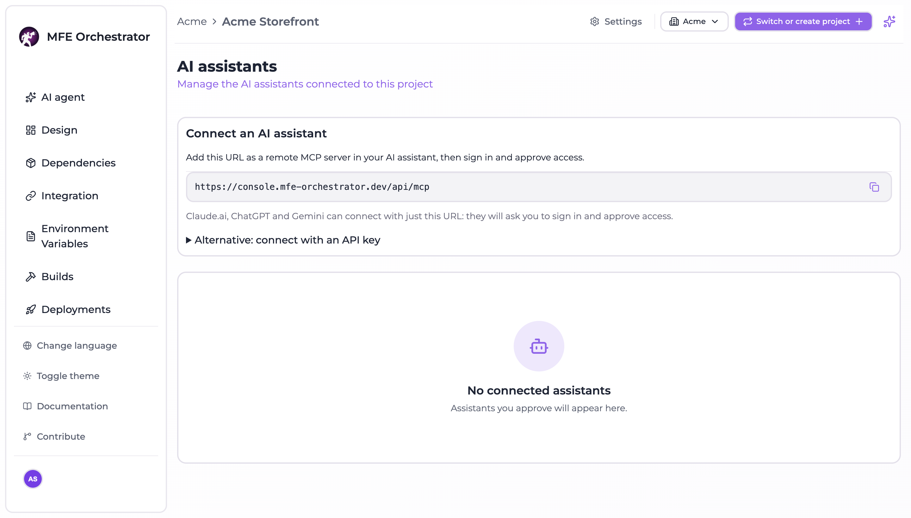

# Connect AI clients with the MCP server

The console exposes its features to AI clients through a remote server speaking the
[Model Context Protocol](https://modelcontextprotocol.io): Claude, Claude Code, ChatGPT, Gemini, Cursor,
VS Code and any other MCP client. You sign in to the console as usual, pick **one or more projects**
and whether the client may change things, and the client acts only inside the projects you picked.

## Connect a client

Open **Settings → General** and, under *People and access*, **Manage** on the **AI assistants** card. The page shows the MCP server URL to copy. With
the default layout it is:

```
https://<your console>/api/mcp
```

Add it as a remote MCP server in your client. Claude.ai, ChatGPT and Gemini need nothing else: they open
the console, you sign in and approve access on the consent page.



```bash
# Claude Code
claude mcp add --transport http mfe-orchestrator https://<your console>/api/mcp
```

On the consent page you choose:

- the **projects**, grouped by organization, with a search box and *Select all* per organization: one
  connection can share several projects;
- **Allow changes** or read only. With changes allowed the client can also create projects, and the page
  says so. A selected project where you are a viewer stays read-only, and the page tells you how many.

The consent page warns you when the client's name cannot be verified, when the code would be sent to a
host other than the client's, or when it goes to a local application. Approve only clients you
recognize.

## What a client can do

| Access | Tools |
| --- | --- |
| **Read only** (`mfe:read`) | Read the project: microfrontends, environments, deployments, canary users, global variables, build status, storages and repository connections (credentials masked), dependency and integration plans, and the [AI context](./ai-context.md) with `context_get` |
| **Read and write** (`mfe:write`) | Everything the console does inside a project, **deploy and rollback included**: create and edit microfrontends and environments, trigger builds, import repositories, rename a microfrontend's repository (`microfrontend_repository_rename`), change global variables, apply dependency alignments and integrations, scaffold a microfrontend with a new repository from a template, change code through a pull request (`code_change_submit`), create projects (`project_create`) |

Your role caps each project separately: on a project where you are a **viewer** every write is refused,
whatever the grant says. Roles are read again on every request, so demoting a member takes write access
away from their clients at once.

Tools marked destructive (deploy, rollback, deletions) are flagged as such to the client: a well-behaved
client asks you before calling them.

### Change the code of a microfrontend

A client changes code the same way a developer does: `repository_checkout_get` tells it how to clone the
microfrontend's repository, it edits locally following the AI context, and `code_change_submit` opens a
pull request against the base branch, which is never written directly. `repository_checkout_get` also returns
the default branch and the AI context of the microfrontend. Repositories a client creates or renames end in `-fe`, for example `checkout-fe`.

### Several projects in one connection

`projects_list` returns the shared projects with their organization and your role. With more than one
shared project every tool needs the `projectId`. A project you lose access to drops out of the
connection on the next request.

### Create a project

`project_create` creates a project in an organization that already contains a shared project, when you
administer it (owner or admin). You become its owner and the project joins the connection at once. One
connection creates at most 10 projects. A client connected before project creation was part of the
consent is asked to reconnect.

### Left out on purpose

API keys, creating or editing storages and repository connections (their input is a secret), deleting
projects, organizations, members, invitations, the connected clients themselves, the pipeline templates
of a project (`project_pipelines_set`, which only [Maestro](./assistant.md) runs), your profile, bundle
upload and the canvas layout. Those stay in the console.

## Connect with an API key

For a client that cannot sign in (a script, a CI job), the MCP server also accepts a project
[API key](../ci-cd/api-keys.md), as `Authorization: Bearer <key>` or as an `api-key` header. The role of
the key decides the access: a `VIEWER` key reads, a `MANAGER` key reads and writes, deploy and rollback
included, but cannot create projects. The key reaches its own project only.

```json
// Cursor: ~/.cursor/mcp.json
{
  "mcpServers": {
    "mfe-orchestrator": {
      "url": "https://<your console>/api/mcp",
      "headers": { "Authorization": "Bearer ${env:MFE_ORCHESTRATOR_API_KEY}" }
    }
  }
}
```

```json
// Gemini CLI: ~/.gemini/settings.json
{
  "mcpServers": {
    "mfe-orchestrator": {
      "httpUrl": "https://<your console>/api/mcp",
      "headers": { "Authorization": "Bearer <api key>" }
    }
  }
}
```

Whoever holds the key acts as the project, not as a person, and there is no consent page. Prefer signing
in whenever the client supports it.

## Revoke access

The **AI assistants** page lists the clients connected to the project, with the user, the access, when
they connected and when they were last used. A project owner (or an organization admin) sees and revokes
everyone's connections; other members see and revoke their own. Revoking removes the whole connection,
all its projects, and takes effect on the client's next request. Maestro can list and revoke them too, after your confirmation.

A connection also ends by itself when you lose access to all its projects, after 30 days without use,
and in any case after 90 days.

## Turning it on

The MCP server is off by default on a self-hosted installation.

| Variable | Default | What it does |
| --- | --- | --- |
| `MCP_ENABLED` | `false` | Mounts the MCP server, the OAuth endpoints and the discovery documents |
| `FRONTEND_URL` | required | Public URL of the console: the consent page lives there |
| `JWT_SECRET` | required | At least 32 bytes (`openssl rand -hex 32`). With MCP on, the backend refuses to start on a missing, placeholder or short secret |
| `MCP_DCR_ENABLED` | `true` | Dynamic client registration, what most clients use today |
| `MCP_CIMD_ENABLED` | `true` | Clients described by a metadata document at an https URL |
| `CIMD_ALLOWED_HOSTS` | any | Hosts whose client metadata documents show as verified on the consent page |
| `MCP_API_KEY_ENABLED` | `true` | Accept project API keys from clients that cannot sign in |
| `MCP_RATE_LIMIT_MAX` | `120` | MCP requests per minute for each connection or API key |
| `TRUST_PROXY` | `127.0.0.1` in the images | Proxies whose `X-Forwarded-For` is trusted, so per-IP rate limits see the real client |

The discovery documents live at the root of the origin, outside `/api`: the bundled nginx already routes
`/.well-known/oauth-protected-resource`, `/.well-known/oauth-authorization-server` and
`/.well-known/openid-configuration` to the backend, and serves `/api/mcp` without buffering. If you put
another proxy in front, do the same. Behind a Kubernetes ingress add the ingress pods to `TRUST_PROXY`,
or every client shares one rate limit bucket:

```yaml
# Helm values
env:
  MCP_ENABLED: "true"
  TRUST_PROXY: "loopback,10.0.0.0/8"   # in-pod nginx + ingress pods in the pod CIDR
```

Clients sign in with OAuth 2.1 (authorization code with PKCE). Access tokens last 15 minutes and are
signed with a key distinct from the console's: a console session cannot call the MCP server, and an MCP
token cannot open a console session.

Without AI configured in the console, the MCP server still works: the client brings its own model.
