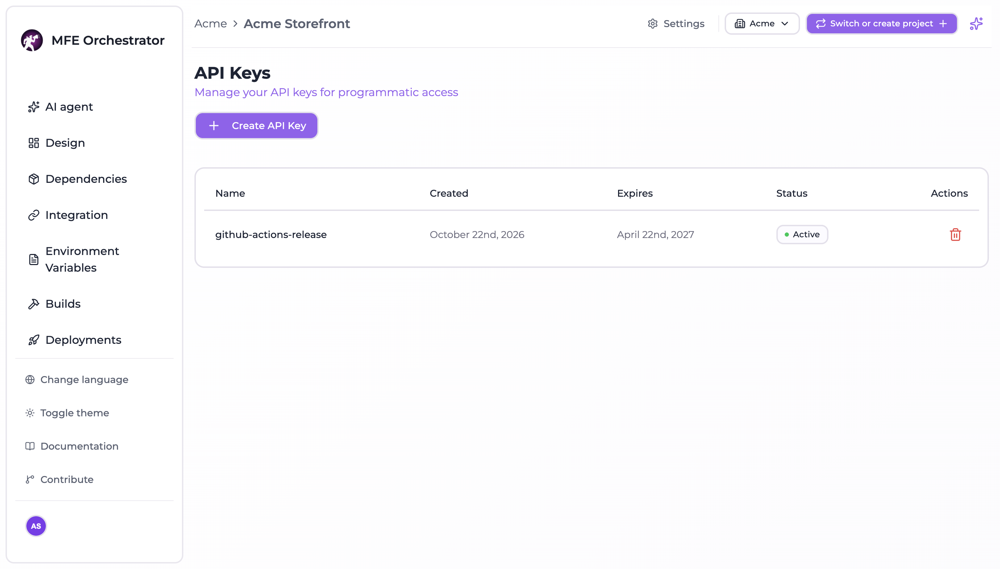
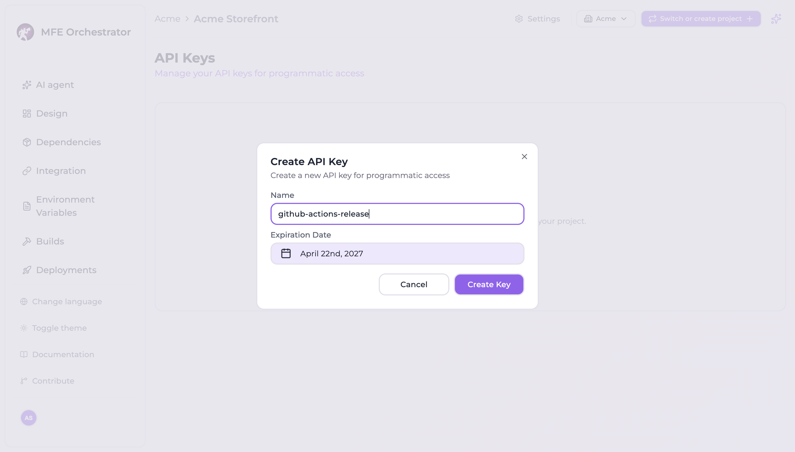

# API keys for CI/CD

An API key authenticates a machine — a CI pipeline, a deploy script, an automation job — against a
single project. Keys live under the project **Settings**: on the **General** tab, **API Keys** in the *People and
access* card.

## Creating a key

1. Open **API Keys** from the project **Settings** and click **Create API Key**.

   

2. Give it a **Name** describing where it will be used, e.g. *catalog GitHub Actions*.
3. Pick an **Expiration Date**. It defaults to six months from today. The date is sent as the
   *start* of the selected day, so pick the day after the last one you want the key to work.
4. Click **Create Key**.

   

The key is displayed once, in a dialog with a **Copy & Close** button.

:::caution Shown exactly once
The key is stored hashed and can never be retrieved again — the list view has no key column at all.
If you lose it, delete the key and create a new one.
:::

## Expiry and revocation are enforced

Every key carries an expiry date, and the list marks it **Active**, **Expiring soon** or
**Expired** from that date. A key that is expired, or revoked, is **refused**: the request fails
with an authentication error that names the reason.

| The key is | The refusal says |
| --- | --- |
| Revoked | `API key revoked` |
| Past its expiry date | `API key expired on <date>` |
| Not known at all | `API key not found` |

The reason is only given for a key that exists, so a pipeline that suddenly fails tells you whether
to rotate the key or to look for a typo.

:::caution Behaviour before 5.0.0
Before release 5.0.0 the authentication check read neither the status nor the expiry of a key, so a
key marked **Expired** kept working and only deleting it stopped it. Both are checked now. A pipeline
that relied on an expired key stops working on upgrade: create a new key and update the consumer.
:::

There is no way to create a non-expiring key. Pick a date you can live with, and rotate by creating
the new key first, updating the consumer, then deleting or revoking the old one.

:::tip
Put the expiry date in whatever calendar your team actually reads: it is the day the pipeline stops
publishing.
:::

## What a key can call

A key authenticates the endpoints meant for pipelines:

```
POST <API_BASE>/microfrontends/by-slug/:slug/upload/:version
POST <API_BASE>/microfrontends/by-slug/:slug/versions/:version
```

The first [uploads a bundle](./manual-upload.md) of a microfrontend, the second registers the Docker
image of a [FRONTEND](./frontend-pipeline.md). A key is also accepted by the
[MCP endpoint](../ai/mcp-server.md), with the access its role gives it.

Everything else on the API — creating a deployment, editing a microfrontend, reading the build
status — is authenticated with the token of a signed-in user and answers an API key with an
authentication error. So a pipeline can *publish* a version, and it cannot *deploy* it; see
[publishing does not deploy](./manual-upload.md#publishing-does-not-deploy).

## Roles

A key carries a role, `MANAGER` or `VIEWER`.

- **You cannot choose it in the console.** The create dialog asks for a name and an expiry date,
  and every key it produces is a `MANAGER`. Keys created automatically for a repository connection
  are `MANAGER` too.
- **Registering an image version needs `MANAGER`.** The endpoint for a FRONTEND answers a key with
  another role with `MICROFRONTEND_VERSION_FORBIDDEN` (403).

Treat the *key itself* as the credential to protect. Anywhere the CI pages ask for a key, any key
the console gives you is the right one.

## Keys created for you

You often do not need to create a key at all. Connecting a code repository — or editing an existing
connection — creates a key and writes it into your Git provider under the name the generated
pipelines read, `MICROFRONTEND_ORCHESTRATOR_API_KEY`. It happens once per connection, not once per
microfrontend, and is skipped when a secret of that name already exists.

| Provider | Where the key is written | Scope |
| --- | --- | --- |
| GitHub | Organization secret, visible to all repositories | The organization on the connection |
| GitLab | Group CI/CD variable | The group you selected on the connection |
| Azure DevOps | Variable group `MFE_ORCHESTRATOR_SECRETS` | The Azure DevOps project |

:::caution A personal GitHub account gets no organization secret
Each injector needs an organization or group id and returns without doing anything when there is
none. A GitHub connection to a personal account has no organization, so no secret is written and a
pipeline in an existing repository cannot authenticate — the publish step fails with an
authentication error on its first run and nothing in the console says why.

For repositories the console creates itself under a personal connection it falls back to a
**repository** secret of the same name, so those work. Repositories you connected by hand need the
secret added by hand: create an [API key](#creating-a-key) and add it as a repository secret named
`MICROFRONTEND_ORCHESTRATOR_API_KEY`.
:::

You will find these keys in the API Keys list named
`MFE_ORCHESTRATOR_DEPLOY_SECRET - <provider> - <repository>`. Do not delete them unless you intend
to break the corresponding pipeline.

:::note Deploy keys last a year
A key created for a connection expires one year after the connection was made. Recreate the deploy
key of the affected pipelines before that date. Keys created by a console older than 5.0.0 were
given fifteen days instead of a year, so any of them older than that is now refused: create a new
key and replace the secret in your pipelines.
:::

## Using a key

Send it in the `api-key` header:

```bash
curl -X POST \
  -H "api-key: $MFE_ORCHESTRATOR_API_KEY" \
  -F "file=@dist.zip" \
  "<API_BASE>/microfrontends/by-slug/catalog/upload/1.4.0"
```

A query parameter is also accepted, for clients that cannot set headers:

```
<API_BASE>/microfrontends/by-slug/catalog/upload/1.4.0?apiKey=…
```

:::caution Prefer the header
Query strings end up in access logs, browser history and proxy logs. Use `?apiKey=` only when
setting a header is genuinely impossible.
:::

The project is derived from the key, so requests authenticated this way do not need a `project-id`
header.

## Stopping a key

- **Delete** is the trash button on the key's row in the list. The record is gone with the key.
- **Revoke** keeps the record and stops the credential. The console list has no Revoke button: call
  `PUT <API_BASE>/api-keys/:apiKeyId/revoke` with a user token, or ask the
  [Maestro assistant](../ai/assistant.md) to revoke the key, which runs the `api_key_revoke` tool after
  you confirm.

Either way the key is refused from that moment on.

## Good practice

**One key per consumer.** A key per pipeline, not one shared across the organisation. Rotating or
revoking then affects one thing, and the name tells you what breaks.

**Never commit a key.** Use your CI's secret store. Keys are UUIDs and match no distinctive pattern,
so secret scanners will not catch one you paste into a repository.

**Scope by project.** A key grants access to its project only. Cross-project automation needs one
key per project — which is the correct blast radius, not an inconvenience to work around.

**Treat a leaked key as a live incident.** Any key can publish arbitrary JavaScript to your
production microfrontends. **Revoke or delete it first, investigate second.** Then create a
replacement and update the consumer.
