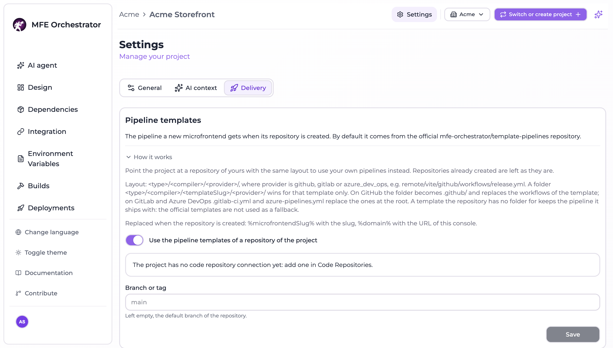

# Your own pipeline templates

When MFE Orchestrator creates a repository from a [template](../templates/templates-library.md), it
copies a pipeline into it: the GitHub workflow, the `.gitlab-ci.yml` or the `azure-pipelines.yml`
described in the other pages of this section. By default those pipelines come from the official
[`template-pipelines`](https://github.com/mfe-orchestrator/template-pipelines) repository.

A project can point at a repository of its own instead, so every repository created afterwards gets
the pipelines your team maintains: your registry, your scans, your naming.

## Set it up

1. Make sure the project has a [code repository connection](../repositories/connect/github.md) that
   reaches the repository holding your pipelines.
2. Open the project **Settings** from the project menu and go to the **Delivery** tab.

   

3. Turn on **Use the pipeline templates of a repository of the project**.
4. Pick the **Connection** and the **Repository**. Only the repositories the connection reaches are
   listed.
5. Optionally fill **Branch or tag**. Left empty, the default branch of the repository is read.
6. Click **Save**.

To go back to the official pipelines, turn the switch off and save.

Only an owner of the project, or an owner or administrator of its organization, can change it.
Repositories that already exist are left as they are: the setting applies to the ones created from
now on.

The same setting is available to the [Maestro assistant](../ai/assistant.md) and to MCP clients as the
`project_pipelines_set` tool, which asks for confirmation before it runs.

## The layout

Your repository has the same layout as `template-pipelines`:

```
<type>/<compiler>/<provider>/                 # e.g. remote/vite/github/
<type>/<compiler>/<templateSlug>/<provider>/  # optional, for one template only
```

- `type` and `compiler` are those of the template: `host` or `remote`, and `vite`, `webpack`,
  `single-spa`, `micro-lc` or `generic`.
- `provider` is `github`, `gitlab` or `azure_dev_ops`.
- A folder with the slug of a template wins over the one without it, for that template only.

What is copied depends on the provider:

| Provider | The folder | Result in the new repository |
| --- | --- | --- |
| GitHub | `workflows/` and the other files of the folder | The folder becomes `.github/` and replaces the workflows of the template |
| GitLab | `.gitlab-ci.yml` | Replaces the file at the root |
| Azure DevOps | `azure-pipelines.yml` | Replaces the file at the root |

For example, one release workflow for every Vite remote on GitHub:

```
remote/vite/github/workflows/build-and-deploy.yml
```

:::caution No fallback to the official pipelines
A template your repository has no folder for keeps the pipeline it ships with. The official
`template-pipelines` are **not** used as a fallback for the project: if the repository you picked is
missing the folder of a template, that template's own pipeline is kept.
:::

## Placeholders

Two placeholders are replaced when the repository is created, on the three providers:

| Placeholder | Replaced with |
| --- | --- |
| `%microfrontendSlug%` | The slug of the microfrontend, as it appears in the console |
| `%domain%` | The base URL of the console, without `/api` |

Start from a copy of the official folders and edit them: they already carry both placeholders and the
publish step, as shown in [GitHub Actions](./github-actions.md), [GitLab CI](./gitlab-ci.md) and
[Azure Pipelines](./azure-pipelines.md).

## When the repository cannot be read

The pipelines are read before anything is created at the provider. If your repository cannot be read
at the branch or tag you set, the creation is refused with `PIPELINE_SOURCE_UNAVAILABLE`, naming the
repository and the reason, and nothing is created. Fix the repository or the ref, or switch back to
the official pipelines, and try again.

The setting itself is refused when:

| Code | Cause |
| --- | --- |
| `PIPELINES_REPOSITORY_REQUIRED` | The connection or the repository is missing |
| `PIPELINES_REPOSITORY_INVALID` | The connection is not one of the project, or cannot reach the repository |
| `PIPELINES_REF_INVALID` | The branch or tag is not a valid name: letters, digits, dots, dashes, underscores and slashes, without `..`, a leading dash, a trailing slash or a trailing `.lock` |
| `PIPELINES_OWNER_REQUIRED` | You are not an owner of the project or an administrator of its organization |
