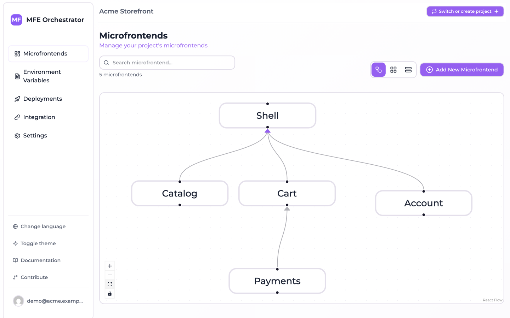
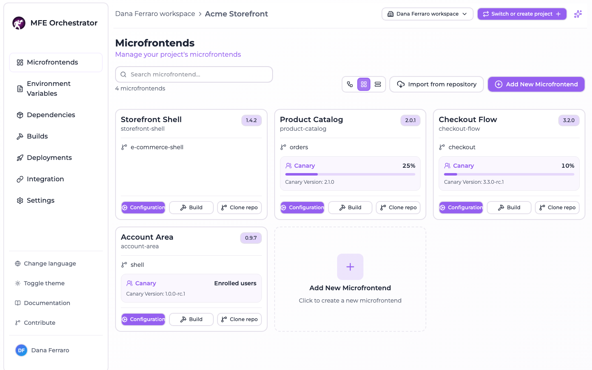
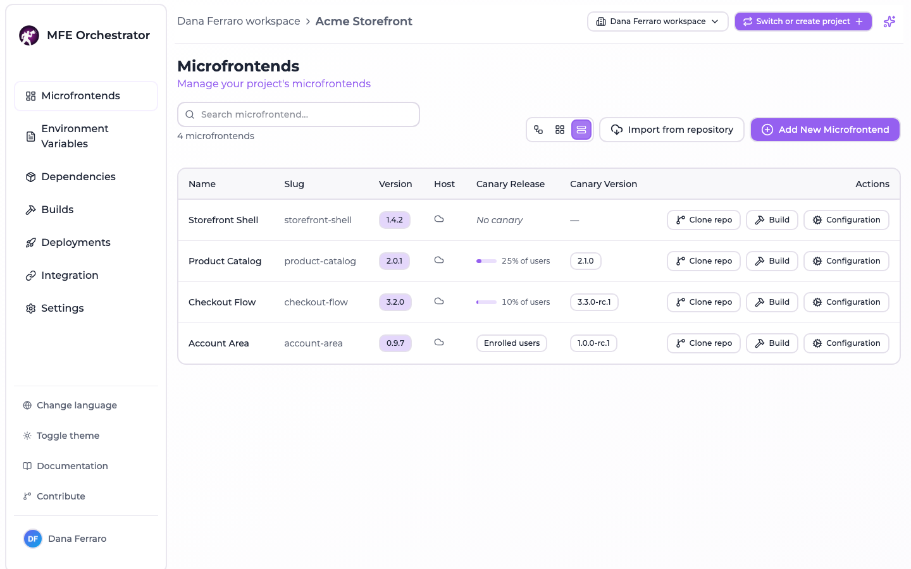

# Frontends overview

The **Frontends** page is the home screen of the console and the place where you spend
most of your time. It lists every frontend registered in the current project with its
version, and — depending on the view you choose — its repository, its hosting type and its
canary release.

## Host and remote

A frontend is registered as one of two types:

| Type | Role |
| --- | --- |
| **Host** | The shell application. It boots the page, owns routing and layout, and loads remotes at runtime. |
| **Remote** | A frontend exposed to be consumed by a host. |

A project normally has one host per application and any number of remotes. A remote can itself
be a host of other remotes — the relations form a graph, not just a two-level tree.

Relations are what make the platform useful: once you declare that `checkout` and `catalog` are
children of `shell`, MFE Orchestrator can generate the exact `remotes` configuration `shell`
needs, pointing at the versions that are actually deployed in each environment. See
[Hosts and remotes](./host-and-remotes.md).

## Views

The dashboard offers three ways of looking at the same data, switchable from the top-right
corner:

- **Diagram view** — the frontend graph, showing which host loads which remotes. Nodes can
  be dragged; their position and size are saved per frontend.

  

- **Grid view** — a card per frontend, showing its version, its linked repository and, when
  one is configured, the canary: the share of traffic it takes as a bar, or *Enrolled users* for a
  [*User* canary](./canary-releases.md#who--the-canary-type), and the canary version underneath.

  

- **Table view** — a dense list, best when a project has many frontends.

  

A free-text search above the views filters the list by name, and the counter next to it says how
many of the total are showing.

## Anatomy of a frontend

| Field | Notes |
| --- | --- |
| **Name** | Display name |
| **Slug** | Lowercase, URL-friendly, **unique within the project**. It appears in serve URLs and becomes the Module Federation remote name, so treat it as permanent. |
| **Description** | Free text |
| **Version** | The version currently selected for this frontend. Only becomes live when you deploy. |
| **Continuous Deployment** | A flag published to consumers on the serve API, marking this frontend as continuously deployed |
| **Hosting type** | Where the files live — see [Hosting options](./hosting-options.md) |
| **Entry Point** | The file a consumer loads. Defaults to `index.js`; Vite Module Federation builds typically use `assets/remoteEntry.js` |
| **Code repository** | Optional link to a GitHub / GitLab / Azure DevOps repository, which enables the **Build** action |
| **Canary** | Optional progressive rollout configuration — see [Canary releases](./canary-releases.md) |

:::caution The slug is fixed at creation
The slug appears in your serve URLs and becomes the remote name in generated Module Federation
configs, so the console does not let you change it afterwards — the field is read-only when you
edit a frontend. Getting a different slug means creating a new frontend and re-pointing
its consumers. Pick one you can live with.
:::

## Where to go next

- [Create a frontend](./create-a-frontend.md) — from a template or from scratch
- [Hosting options](./hosting-options.md) — hub, your own bucket, or an external URL
- [Versions and builds](./versions-and-builds.md) — how a version gets created and uploaded
- [Hosts and remotes](./host-and-remotes.md) — wiring the graph
- [Canary releases](./canary-releases.md) — progressive rollout
