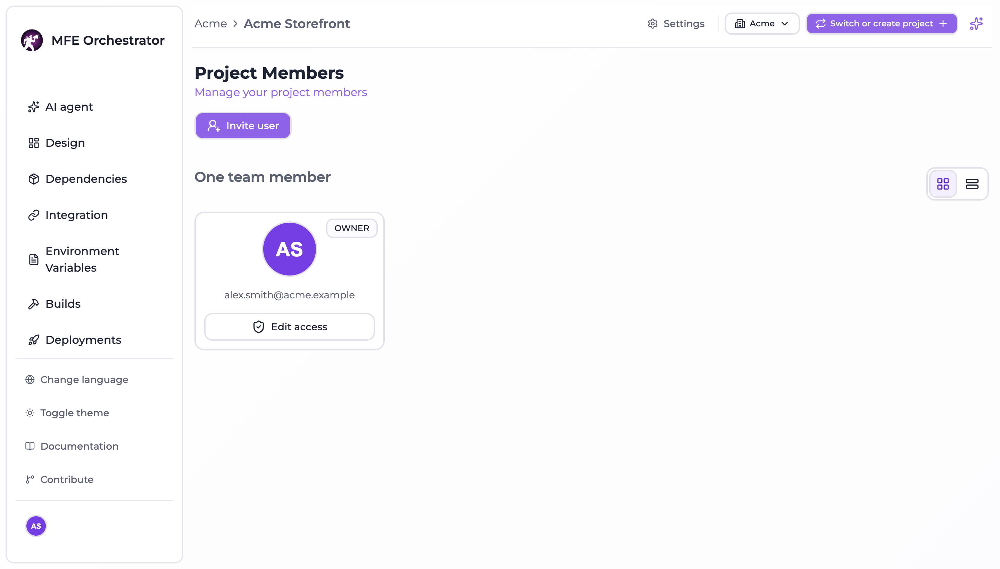
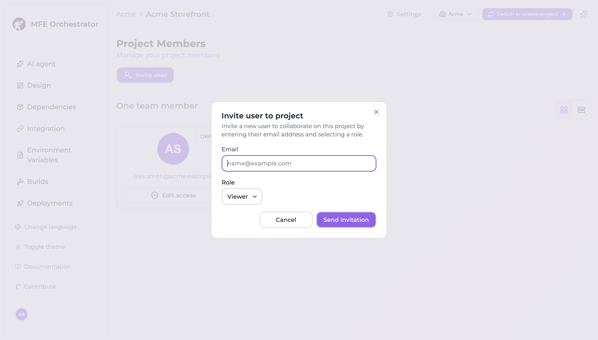

# Project members and roles

A user can be a member of several projects, and a role is recorded for them in each one: **Admin**,
**Editor** or **Viewer**. The role decides who manages the project's members and, for a Viewer, which
writes are refused. Membership itself stays the boundary inside a project — read
[What each role can do](#what-each-role-can-do) before you invite anybody, because the role does not
make everything read-only.

Which projects a person can reach at all is decided one level up, by the organization that owns
them:

> The [organization role](../organizations/roles-and-visibility.md) answers *which projects*.
> Project membership answers *whether this is one of them*, and the project role *what, inside it*.

Two consequences are worth keeping in mind while reading the rest of this page:

- **Whoever administers the organization reaches every project in it**, invited or not, and acts
  there as an owner of the project. Somebody who must be held back by a project role cannot be an
  organization owner or admin.
- **Inviting somebody to a project also puts them into the owning organization**, as a plain member.
  See [Inviting a member](#inviting-a-member) below.

Members live on their own page, reached from the **Team Members** card of **Settings → General**.

## Roles

There are three, and the console and the API name them differently:

| Role in the console | Stored and returned by the API as | Notes |
| --- | --- | --- |
| **Admin** | `OWNER` | The last Admin of a project cannot be removed or demoted |
| **Editor** | `MEMBER` | |
| **Viewer** | `VIEWER` | The value the invite dialog starts on |

The **invite dialog** and the **Edit access** dialog offer *Admin*, *Editor* and *Viewer*; the badge
on the members list prints the stored value — `OWNER`, `MEMBER` or `VIEWER` — and so does the API.
Invitation emails name the role as well.

## What each role can do

The platform checks the role in a fixed set of places. Everywhere else, being a member is what
counts.

| | Admin | Editor | Viewer |
| --- | :---: | :---: | :---: |
| Invite, resend, revoke and remove members; change their role | Yes | No | No |
| Choose where the pipeline templates come from ([Delivery](./projects.md#ai-context-and-pipeline-templates)) | Yes | No | No |
| Add, edit, test and delete a [storage](../buckets/overview.md) | Yes | Yes | No |
| Create or rename the code repository of a microfrontend | Yes | Yes | No |
| Ask for an [Edit with AI](../microfrontends/edit-with-ai.md) change, or apply one | Yes | Yes | No |
| Make changes through the [assistant](../ai/assistant.md) or an [MCP client](../ai/mcp-server.md) | Yes | Yes | No, read only |

An organization owner or admin acts as an Admin on every project of the organization. The refusals
come from the API, with codes such as `PROJECT_OWNER_REQUIRED`, `PIPELINES_OWNER_REQUIRED` and
`STORAGE_WRITE_FORBIDDEN`, and they apply whichever client sends the request.

:::caution A Viewer is not read-only everywhere
The rows above are the whole list. Microfrontends, environments, variables, deployments, renaming
and deleting the project are not checked against the role: whoever is a member of the project can do
them, a Viewer included. Invite somebody to a project only if you would let them do those things, and
put the work of anybody who must not in a separate project.
:::

Keep at least two Admins, so a project whose only Admin has left can still have its members managed.
An organization admin can step in either way.

### Restricting who can deploy to production

There is no way to do this inside one project: there is no per-environment permission split, and
deploying is not checked against the role, so an Editor and a Viewer can both deploy `prod` as soon as
they are members. The mechanism that works is a **separate project** for production, whose membership
is the smaller group. The ability to ship and the ability to
[roll back](../deployments/rollback-and-redeploy.md) travel together in any case: both are a
deployment.

## Inviting a member

1. Open **Team Members** from **Settings → General** and click **Invite user**. Only an Admin of the project, or an administrator of its organization, can.

   

2. Enter their **email address**.
3. Choose a **role**.
4. **Send invitation**.

   

An email goes out with an invitation link. The invitee follows it, signs in or registers, and joins
the project with the role you chose — see
[Accepting an invitation](../account/email-flows.md#accepting-an-invitation) for the screen they land
on and how long the link lives.

:::info The invitation reaches the organization too
A project sits inside an organization, so inviting somebody to a project also adds them to that
organization — as a plain **member**, created already accepted. That membership grants nothing on
its own: a plain member reaches only the projects they were invited to, which is exactly the project
you just invited them to. Somebody who already holds a role in the organization keeps it; a project
invitation never demotes an admin. Declining the invitation takes the implicit membership back
again, unless they have other projects there. See
[Roles and project visibility](../organizations/roles-and-visibility.md#inviting-to-a-project-creates-a-membership-in-the-organization).
:::

:::caution Without SMTP an invitation becomes an unverified membership
Invitations are delivered by email, so the installation needs SMTP configured. On a self-hosted
instance without `EMAIL_SMTP_HOST` set the invitation does not fail — it degrades. No email is sent,
no link is generated, and the address you typed is added to the project as an **already active
member**, with nothing having proved that the person owns that address. Resending an invitation is
the only action that errors in that state.

That means a typo gives the project to whoever owns the address you mistyped, with the role you
chose. Configure SMTP before you invite anybody — see
[Environment Variables](../self-hosting/environment-variables.md).
:::

## Managing invitations

Accepted members and pending invitations are two separate sections of the page, not one list with a
status column:

| Section | Columns |
| --- | --- |
| Members — as cards, or as a table from the view switcher | User, Role, Actions |
| **N pending invitations** — the heading counts them, and appears only when there are any | Email, Role, Expires on, Actions |

An invitation expires five days after it is sent, which is the date under **Expires on**.

For a pending invitation you can:

- **Edit access** — change the role the invitation was sent with.
- **Resend** — send the email again, for the classic case of it landing in spam. The only action with
  a visible label, and even that is hidden on a narrow window.
- **Revoke** — cancel it, so the link no longer works. An icon-only button: the **✕** at the end of
  the row, which names itself on hover.

## Changing a role

Use **Edit access**, the shield button on a member's card or row, and on a pending invitation. It
opens a dialog with the **Role** selector (*Admin*, *Editor*, *Viewer*) and **Save**. The button is
offered to the project's Admins and to the administrators of its organization; nobody else sees it,
since the API would refuse them.

The last Admin cannot be demoted: the dialog says *The project needs at least one admin: promote
another member first.*

## Removing a member

Remove them from the row's actions — the trash icon in the table, the **Remove** button on the card.
The confirmation is a plain dialog naming the person ("Are you sure you want to remove … from this
project?"), not the type-the-name gesture that [deleting a project](./projects.md#deleting-a-project)
asks for. The button is disabled for the last Admin, and when the project would be left with no
members at all. Only an Admin of the project, or an administrator of its organization, can remove
somebody.

They lose access to this project immediately; their account and their membership of other projects
are unaffected.

:::caution Removing them from the project does not remove them from the organization
Somebody who accepted the invitation stays in the organization as a plain member with no project —
harmless, since that grants nothing, but they remain on the organization's members list. Take them
out from [the organization page](../organizations/managing-an-organization.md#members) if you want
them gone entirely; doing so also removes them from every other project of that organization. An
invitation that was never accepted is cleaned up on its own when you revoke it.
:::

:::tip Removing a person is not enough
People leaving is also the moment to audit [API keys](../ci-cd/api-keys.md). A key that person
created keeps working after they are removed — keys belong to the project, not to the user who
created one. **Delete** any key they were the only consumer of, as [Machine access](#machine-access)
explains.
:::

## Authentication

How members sign in depends on the installation:

| Method | Notes |
| --- | --- |
| Email and password | Available when embedded login is enabled |
| Google | Available when configured |
| Microsoft Entra ID (Azure) | Available when configured |
| Auth0 | Available when configured |

The hosted console offers email/password and Google. For self-hosted installations, the enabled
providers are whichever you configure — see
[Enable SSO](../self-hosting/enable-sso/Google.md).

Whichever method a user signs in with, their memberships are the same: authentication decides who
they are, project membership decides which projects they reach.

## Machine access

For CI pipelines and scripts, use [API keys](../ci-cd/api-keys.md) rather than a user account. A key
belongs to the project, so it survives any change to your own account.

The create dialog asks for two things, a **name** and an **expiration date**; the role is not among
them, and every key the console creates is stored as `MANAGER`.

:::info Revoked and expired keys are refused
An API key whose status is revoked, or whose expiration date has passed, is refused when it
authenticates, and the refusal names the reason. The console lets you create and delete keys; deleting one removes it for good. See
[API keys](../ci-cd/api-keys.md).
:::

Creating a "service user" with a shared password is the anti-pattern here: it cannot be rotated
without coordinating with everyone using it, and it muddies the audit trail.
